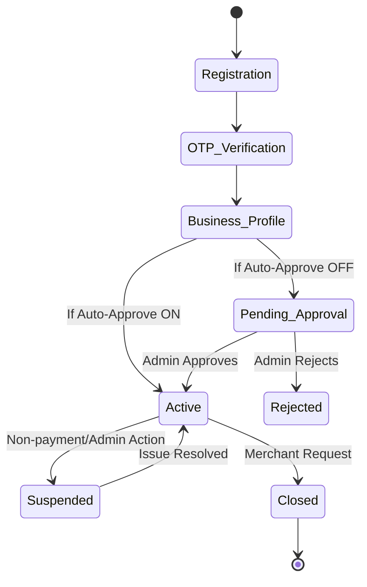

# Software Requirements Specification (SRS) - Part 1
## Shoppie Platform (Sections 1-6)

---

## SECTION 1 — EXECUTIVE SUMMARY

### 1.1 Project Vision
To empower local merchants in Indian Tier-3/4 towns with an AI-driven, affordable, and mobile-first integrated commerce platform that digitizes their operations and connects them with their local communities.

### 1.2 Business Opportunity
The Indian retail market is massive, valued at over $900 billion, with the vast majority driven by unorganized local merchants. However, less than 5% of these small-town merchants are digitized. There is an immense, untapped opportunity to bring modern commerce tools to these businesses.

### 1.3 Problems Being Solved
*   **Merchants:** Lack affordable, easy-to-use digital tools for inventory, sales, and online presence. Existing solutions are either too complex, require high commissions, or target English-speaking urban businesses.
*   **Customers:** Cannot easily discover local products online, check local store inventory without calling or visiting, or order from neighborhood shops conveniently.

### 1.4 Proposed Solution
"Shoppie" is an integrated platform combining:
*   **AI-Powered Merchant SaaS:** To manage store operations (inventory, billing, delivery).
*   **Hyperlocal Multi-Vendor Marketplace:** A consumer app for customers to discover and buy from local merchants.
*   **AI Business & Shopping Assistants:** To help merchants with tasks and customers with discovery (Phase 2).

### 1.5 Target Users
*   **Merchants:** Small to medium local businesses (grocery, clothing, electronics, etc.).
*   **Customers:** Local residents looking for convenience and quick delivery/pickup from trusted neighborhood stores.

### 1.6 Unique Value Proposition (UVP)
*   **AI-Native but Invisible:** AI assists behind the scenes without overwhelming users.
*   **Affordable:** Zero-commission base model, freemium SaaS.
*   **Local Language Support:** Telugu (and later Hindi) interfaces.
*   **Hyperlocal Focus:** Pincode-based delivery and discovery tailored for small towns.

### 1.7 Initial Market
The platform will launch initially in **Varni and Nizamabad (Telangana, India)**.

### 1.8 Long-Term Expansion
Pan-India rollout targeting Tier-2, Tier-3, and Tier-4 cities following the playbook established in the initial markets.

### 1.9 Business Sustainability
The platform utilizes a **Freemium SaaS** model with paid tiers (Basic, Professional, Premium) based on product limits, order volume, and advanced features (e.g., custom domains). 

### 1.10 Major Project Risks & Assumptions
*   **Risks:** Low digital literacy causing adoption friction; AI infrastructure costs scaling poorly; single technical founder dependency limiting speed.
*   **Assumptions (Requiring Validation):** Merchants are willing to pay a flat SaaS fee instead of a commission; customers want to buy online from local stores rather than giant e-commerce players; local delivery can be managed efficiently by merchants themselves.
*   **Why Choose Shoppie?** Merchants keep 100% of their sales (no commission) while getting a digital storefront. Customers get same-day access to local goods without waiting for national shipping.

---

## SECTION 2 — PRODUCT VISION AND BUSINESS MODEL

### 2.1 Business Model Analysis
We evaluated four primary models:

1.  **Model A: SaaS (Subscription)**
    *   *Revenue Potential:* Predictable recurring revenue.
    *   *Acquisition Difficulty:* Moderate; requires demonstrating ROI for the subscription fee.
    *   *Operational Complexity:* Low. No payment routing or tax split logic.
    *   *Risks:* High churn if merchants don't see immediate sales.
2.  **Model B: Commission (Marketplace)**
    *   *Revenue Potential:* High upside if GMV scales.
    *   *Acquisition Difficulty:* Low initial barrier, but high resistance from Indian merchants to giving up margins.
    *   *Operational Complexity:* High. Requires platform nodal accounts, complex split payouts, and GST compliance.
3.  **Model C: Hybrid (SaaS + Commission)**
    *   *Revenue Potential:* Highest.
    *   *Acquisition Difficulty:* High resistance from merchants.
4.  **Model D: Value-Added Services (VAS)**
    *   *Revenue Potential:* Supplemental (ads, premium placement).
    *   *Operational Complexity:* Medium.

### 2.2 Recommended Model
**Recommendation for MVP: Freemium SaaS (Model A) + Optional VAS (Model D).**
*Commission is disabled for MVP but built-in and toggleable via feature flags.* All prices are configurable via the database (`subscription_plans`).

### 2.3 Revenue Comparison Table

| Plan | Monthly Price | Products | Orders/mo | Custom Domain | Gross Revenue (100 users) | Net Revenue (Post 2% Gateway Fee) |
| :--- | :--- | :--- | :--- | :--- | :--- | :--- |
| **Free** | ₹0 | 50 | 100 | No | ₹0 | ₹0 |
| **Basic** | ₹499 | 500 | Unlimited | No | ₹49,900 | ₹48,902 |
| **Professional** | ₹999 | 2,000 | Unlimited | Yes | ₹99,900 | ₹97,902 |
| **Premium** | ₹1,999 | Unlimited | Unlimited | Yes | ₹199,900 | ₹195,902 |

*(All values above are configurable via `subscription_plans` table)*

---

## SECTION 3 — STAKEHOLDER ANALYSIS

### 3.1 Stakeholder Profiles

| Stakeholder | Objectives | Responsibilities | Problems Solved | Success Criteria |
| :--- | :--- | :--- | :--- | :--- |
| **Super Admin (Platform Owner)** | Maximize adoption and revenue; ensure platform stability. | System config, merchant approval, global support. | Lack of scalable SaaS for small towns. | High MRR, low churn, system uptime > 99.9%. |
| **Merchant Admin (Owner)** | Digitize store, increase sales, manage inventory efficiently. | Manage store, subscription, staff, and catalogue. | Manual inventory, limited reach. | Increased sales, time saved on operations. |
| **Merchant Manager** | Oversee daily operations. | Manage orders, products, handle disputes. | Inefficient order tracking. | Smooth daily order fulfillment. |
| **Merchant Cashier/Staff** | Process walk-in/online orders. | Update inventory, pack orders. | Complex billing systems. | Fast processing, zero errors. |
| **Customer (Registered)** | Find local products quickly, order conveniently. | Browse, purchase, review. | Inability to know if local store has an item. | Fast delivery/pickup, easy UI. |
| **Guest User** | Browse without commitment. | Discover local stores. | Forced signups block discovery. | Seamless transition to registered user. |
| **Customer Support (Platform)** | Resolve platform issues. | Ticket handling, onboarding help. | Lack of merchant digital literacy. | High CSAT, fast resolution. |
| **Delivery Personnel (Merchant's)**| Deliver goods efficiently. | Fulfill local orders. | Unoptimized routes. | Timely deliveries. |
| **Payment Gateway (Razorpay)** | Process transactions. | Secure payment routing. | Payment collection friction. | 100% success rate on valid transactions. |
| **SMS/Email Provider** | Deliver notifications. | OTPs, order updates. | Communication gaps. | High delivery rate. |
| **AI Provider (OpenAI)** | Provide intelligence. | Auto-tagging, assistants. | Manual data entry. | Fast API response. |

### 3.2 Stakeholder to Feature Mapping

| Feature Module | Super Admin | Merchant Admin | Merchant Staff | Customer |
| :--- | :--- | :--- | :--- | :--- |
| Storefront/Marketplace | Manage listings | Config store | Update stock | Browse & Buy |
| Order Management | View platform metrics | View all orders | Process orders | Track order |
| Subscription Management| Config plans | Upgrade/Downgrade | N/A | N/A |
| RBAC | Config global roles | Assign staff roles | N/A | N/A |

---

## SECTION 4 — USER ROLES AND ACCESS CONTROL

### 4.1 Role-Based Access Control (RBAC)
The platform uses strict multi-tenancy based on PostgreSQL Row-Level Security (RLS). Tenant isolation ensures a Merchant Admin can only see their own store data. 

**RBAC-FR-001: System Roles Configuration**
*   **Description:** The system must support predefined roles for users.
*   **Configurable:** DB-driven (`roles` table).

### 4.2 Permission Matrix

| Permission | Super Admin | Merchant Admin | Merchant Manager | Merchant Staff | Customer |
| :--- | :--- | :--- | :--- | :--- | :--- |
| Platform Config | Full | None | None | None | None |
| Approve Merchants | Yes | None | None | None | None |
| Manage Own Store Settings | None | Yes | View Only | View Only | None |
| Manage Staff | None | Yes | None | None | None |
| Manage Products | None | Yes | Yes | View Only | View Only |
| Process Orders | None | Yes | Yes | Yes | None |
| View Analytics | Platform | Store | Store | None | None |
| Place Orders | None | None | None | None | Yes |

**RBAC-FR-002: Tenant Isolation**
*   **Description:** All queries by merchant users MUST be implicitly filtered by `merchant_id`.
*   **Acceptance Criteria:** 
    *   *Given* a logged-in Merchant Staff, *When* they query `/api/orders`, *Then* they only receive orders belonging to their `merchant_id`.

**RBAC-FR-003: Least Privilege Execution**
*   **Description:** Users can only perform actions explicitly granted by their role matrix.

---

## SECTION 5 — MERCHANT ONBOARDING AND MANAGEMENT

### 5.1 Onboarding State Machine

### 5.2 Functional Requirements

**MER-FR-001: Merchant Registration**
*   **Description:** Merchant signs up using phone number.
*   **Actor:** Merchant Owner
*   **Preconditions:** Phone number not already registered.
*   **Trigger:** Clicks "Register".
*   **Workflow:** 1. Enter Phone. 2. Request OTP.
*   **Configurable:** OTP Provider (ENV).
*   **Acceptance Criteria:** Given a new phone number, When submitted, Then OTP is sent.

**MER-FR-002: OTP Verification**
*   **Description:** Verify phone number via OTP.
*   **Validation Rules (VR-001):** Must be 6 digits.

**MER-FR-003: Business Profile Setup**
*   **Description:** Enter business name, address, pincode.

**MER-FR-004: GST Configuration (Optional)**
*   **Description:** Merchant can optionally provide GSTIN. Indian small merchants may not have GST.
*   **Configurable:** `is_gst_mandatory` (DB flag, default: false).

**MER-FR-005: Category Selection**
*   **Description:** Select primary business category.

**MER-FR-006: Store Configuration**
*   **Description:** Set store hours, logo, and basic policies.

**MER-FR-007: Employee Management**
*   **Description:** Add staff members. Limits based on subscription plan.

**MER-FR-008: Subscription Plan Selection**
*   **Description:** Select Free or Paid tier.
*   **Configurable:** `subscription_plans` (DB).

**MER-FR-009: Payment Setup**
*   **Description:** Link bank account or UPI for direct payouts.

**MER-FR-010: Merchant Activation (Approval)**
*   **Description:** Account becomes active.
*   **Configurable:** `auto_approve_merchants` (FLAG, default: false).

**MER-FR-011: Suspension**
*   **Description:** Super Admin can suspend a merchant.

**MER-FR-012: Closure**
*   **Description:** Merchant can request account deletion.

---

## SECTION 6 — MERCHANT ONLINE STOREFRONT

The storefront and the marketplace share the exact same underlying PostgreSQL records (Single Source of Truth).

**STORE-FR-001: Store Profile Display**
*   **Description:** Display store name, logo, banner, and description.
*   **Acceptance Criteria:** Given an active store, When a user visits the store URL, Then the store branding is displayed.

**STORE-FR-002: Product Catalogue Visibility**
*   **Description:** Display products categorized logically.
*   **Business Rules (BR-001):** Only products with `is_published=true` and `stock > 0` are visible to customers.

**STORE-FR-003: Contact & Store Hours**
*   **Description:** Display operational hours and contact info. Show "Open" or "Closed" badge dynamically.

**STORE-FR-004: Delivery Areas**
*   **Description:** Store must define supported pincodes.
*   **Configurable:** Default delivery radius/pincodes via `delivery_zones` table.

**STORE-FR-005: Custom Domain Support**
*   **Description:** Premium merchants can map a custom domain to their storefront.
*   **Configurable:** Enabled via `subscription_plans` (Professional/Premium).

**STORE-FR-006: Dedicated Store URL**
*   **Description:** Every store gets a platform subdomain (e.g., `storename.shoppie.in`).

**STORE-FR-007: Reviews & Ratings Visibility**
*   **Description:** Show aggregate ratings and customer reviews on the storefront.

**STORE-FR-008: Store Offers & Banners**
*   **Description:** Merchants can configure promotional banners for their storefront.
