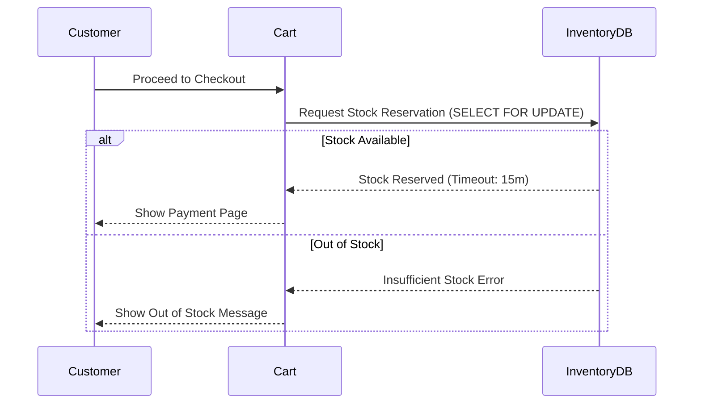
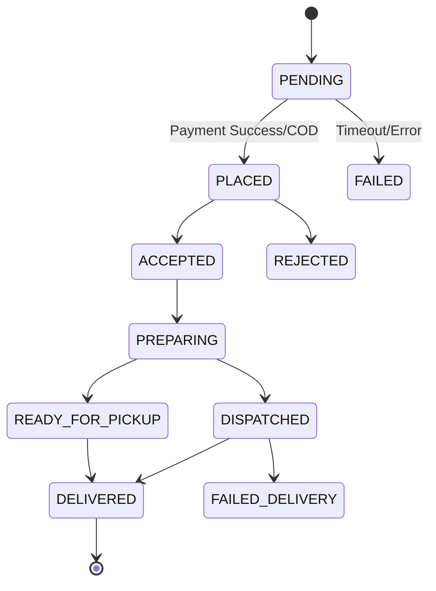

# SECTION 7 — PRODUCT CATALOGUE MANAGEMENT

## 7.1 Overview
The product catalogue allows merchants to manage their offerings. We recommend **independent merchant catalogues** for the MVP. This gives merchants full control over their pricing, inventory, and descriptions without waiting for platform approval. A shared master catalogue can be introduced in a future phase (configurable via feature flag). All categories and attributes are configurable via the database.

## 7.2 Functional Requirements

### CAT-FR-001: Product Creation
- **Description**: Merchants can create a new product by providing details like name, category, and base price.
- **Actor**: Merchant
- **Preconditions**: Merchant account is active.
- **Trigger**: Merchant clicks "Add Product".
- **Main Workflow**:
  1. Merchant selects a category (Grocery, Clothing, etc.).
  2. Merchant enters product name, description, SKU, and base price.
  3. System validates input and saves the product in draft state.
- **Business Rules**: 
  - BR-CAT-01: Base price must be > 0.
  - BR-CAT-02: Categories are configurable via DB (`business_categories`).
- **Validation Rules**:
  - VR-CAT-01: SKU must be unique within the merchant's catalogue.
- **Error Conditions**: Duplicate SKU returns error message.
- **Acceptance Criteria**: Given valid product details, When the merchant saves, Then a new product is created in draft state.
- **Priority**: P0
- **Dependencies**: None
- **Configurable**: Yes (Categories, mandatory fields).

### CAT-FR-002: Product Editing
- **Description**: Merchants can edit existing product details.
- **Actor**: Merchant
- **Preconditions**: Product exists.
- **Trigger**: Merchant selects product and clicks "Edit".
- **Main Workflow**:
  1. Merchant updates fields.
  2. System validates and saves changes.
- **Business Rules**:
  - BR-CAT-03: Editing an active product updates the storefront immediately.
- **Acceptance Criteria**: Given an existing product, When edited and saved, Then the updated details reflect in the database.
- **Priority**: P0
- **Configurable**: No

### CAT-FR-003: Category and Subcategory Management
- **Description**: Platform admin defines categories/subcategories; merchants select from these.
- **Actor**: Admin / Merchant
- **Priority**: P0
- **Configurable**: Yes (DB `categories` table)

### CAT-FR-004: Product Images
- **Description**: Merchants can upload up to 5 images per product.
- **Actor**: Merchant
- **Priority**: P0
- **Configurable**: Yes (Max images configurable via DB `platform_config`)

### CAT-FR-005: Product Descriptions
- **Description**: Merchants can add rich text descriptions for products.
- **Actor**: Merchant
- **Priority**: P1
- **Configurable**: No

### CAT-FR-006: Product Variants
- **Description**: Merchants can create variants (e.g., size, color) for a product.
- **Actor**: Merchant
- **Priority**: P1
- **Configurable**: Yes (Variant types defined in DB)

### CAT-FR-007: SKU Management
- **Description**: System allows manual or auto-generation of SKUs.
- **Actor**: Merchant
- **Priority**: P0
- **Configurable**: Yes (Auto-generation format)

### CAT-FR-008: Barcode Assignment
- **Description**: Merchants can associate standard barcodes (UPC/EAN) with products.
- **Actor**: Merchant
- **Priority**: P2
- **Configurable**: Yes (Feature flag `barcode_enabled`)

### CAT-FR-009: Product Attributes
- **Description**: Merchants can define custom attributes (e.g., brand, material).
- **Actor**: Merchant
- **Priority**: P1
- **Configurable**: Yes (Custom attributes allowed per category)

### CAT-FR-010: Unit of Measure (UOM)
- **Description**: Products must have a defined UOM (kg, liter, piece, etc.).
- **Actor**: Merchant
- **Priority**: P0
- **Configurable**: Yes (UOM list in DB)

### CAT-FR-011: Pricing Management
- **Description**: Merchants can set MRP and selling price.
- **Actor**: Merchant
- **Priority**: P0
- **Configurable**: No

### CAT-FR-012: Discounts and Offers
- **Description**: Merchants can apply percentage or flat discounts.
- **Actor**: Merchant
- **Priority**: P1
- **Configurable**: Yes (Discount types configurable)

### CAT-FR-013: Tax Classification
- **Description**: Products can be assigned a tax slab (GST percent).
- **Actor**: Merchant
- **Priority**: P0
- **Configurable**: Yes (Tax slabs in DB)

### CAT-FR-014: Stock Availability Toggle
- **Description**: Merchants can manually toggle products as "In Stock" or "Out of Stock" regardless of actual count.
- **Actor**: Merchant
- **Priority**: P0
- **Configurable**: No

### CAT-FR-015: Product Visibility
- **Description**: Merchants can hide products from the storefront without deleting them.
- **Actor**: Merchant
- **Priority**: P0
- **Configurable**: No

### CAT-FR-016: Bulk Import/Export
- **Description**: Merchants can upload or download CSV/Excel files for bulk product management.
- **Actor**: Merchant
- **Priority**: P1
- **Configurable**: Yes (CSV mapping configurable)

### CAT-FR-017: Product Archival
- **Description**: Products can be archived (soft deleted) instead of hard deleted.
- **Actor**: Merchant
- **Priority**: P0
- **Configurable**: No

# SECTION 8 — INVENTORY MANAGEMENT

## 8.1 Overview
Inventory management ensures accurate stock tracking. Overselling is prevented using database-level pessimistic locking (`SELECT FOR UPDATE`) during the order placement transaction. AI assistants are strictly prohibited from modifying inventory without explicit human authorization.

## 8.2 Functional Requirements

### INV-FR-001: Stock Entry
- **Description**: Merchants can add initial stock or restock items.
- **Priority**: P0
- **Configurable**: No

### INV-FR-002: Stock Adjustment
- **Description**: Merchants can manually increase or decrease stock levels to correct discrepancies.
- **Priority**: P0
- **Configurable**: No

### INV-FR-003: Movement History
- **Description**: System logs all inventory changes (sales, restocks, adjustments) with timestamps and actor IDs.
- **Priority**: P1
- **Configurable**: No

### INV-FR-004: Reorder Levels
- **Description**: Merchants can define a minimum threshold for each product.
- **Priority**: P1
- **Configurable**: Yes (Thresholds per product)

### INV-FR-005: Low-Stock Alerts
- **Description**: System alerts the merchant when stock falls below the reorder level.
- **Priority**: P1
- **Configurable**: Yes (Alert frequency/methods)

### INV-FR-006: Stock Reservation
- **Description**: Stock is temporarily reserved when a customer initiates checkout.
- **Priority**: P0
- **Configurable**: Yes (Reservation timeout, default 15 mins)

### INV-FR-007: Reservation Release
- **Description**: Reserved stock is released back if checkout is abandoned or payment fails.
- **Priority**: P0
- **Configurable**: Yes (Timeout duration)

### INV-FR-008: Returns to Stock
- **Description**: Cancelled or returned orders can automatically return items to inventory.
- **Priority**: P1
- **Configurable**: Yes (Auto-return toggle)

### INV-FR-009: Damaged Stock Marking
- **Description**: Merchants can mark inventory as damaged, reducing sellable stock without registering a sale.
- **Priority**: P2
- **Configurable**: No

### INV-FR-010: Multi-Location Support (Phase 2)
- **Description**: Merchants can track inventory across multiple stores or warehouses.
- **Priority**: P3
- **Configurable**: Yes (Feature flag `multi_location_enabled`)

### INV-FR-011: Inventory Reconciliation
- **Description**: System provides tools for periodic physical stock checks.
- **Priority**: P2
- **Configurable**: No

### INV-FR-012: Inventory Reports
- **Description**: Merchants can view and export current stock levels and valuation.
- **Priority**: P1
- **Configurable**: Yes (Report formats)

## 8.3 Stock Reservation Flow

# SECTION 9 — CUSTOMER MARKETPLACE

## 9.1 Overview
The marketplace allows customers to discover local merchants and products. For the MVP, location matching is pincode-based. If inaccurate location data is encountered, users can manually select their pincode.

## 9.2 Functional Requirements

### MKT-FR-001: Customer Registration
- **Description**: Customers can create an account using phone number/OTP or email.
- **Priority**: P0
- **Configurable**: Yes (Auth methods in Supabase)

### MKT-FR-002: Guest Browsing
- **Description**: Unregistered users can browse merchants and products.
- **Priority**: P0
- **Configurable**: Yes (`guest_browsing_enabled` flag)

### MKT-FR-003: Location Selection
- **Description**: Customers set their active pincode to see deliverable merchants.
- **Priority**: P0
- **Configurable**: Yes (Pincode database)

### MKT-FR-004: Merchant Discovery
- **Description**: Customers can view a list of local merchants serving their pincode.
- **Priority**: P0
- **Configurable**: Yes (Default sorting algorithms)

### MKT-FR-005: Product Discovery
- **Description**: Customers can view products available from local merchants.
- **Priority**: P0
- **Configurable**: No

### MKT-FR-006: Global Search
- **Description**: Customers can search for specific products or merchants by name.
- **Priority**: P0
- **Configurable**: Yes (Search weights and fuzzy matching)

### MKT-FR-007: Category Browsing
- **Description**: Customers can browse products and merchants by standardized categories.
- **Priority**: P0
- **Configurable**: Yes (Categories in DB)

### MKT-FR-008: Search Filters
- **Description**: Customers can filter results by price, category, rating, etc.
- **Priority**: P1
- **Configurable**: Yes (Available filter fields)

### MKT-FR-009: Price Comparison
- **Description**: Customers can see equivalent products from different local merchants.
- **Priority**: P2
- **Configurable**: Yes (Matching threshold)

### MKT-FR-010: Product Details
- **Description**: Detailed view showing product images, description, price, and merchant info.
- **Priority**: P0
- **Configurable**: No

### MKT-FR-011: Merchant Profiles
- **Description**: Dedicated page for a merchant showing their full catalogue and details.
- **Priority**: P0
- **Configurable**: Yes (Profile layout variants)

### MKT-FR-012: Cart Management
- **Description**: Customers can add/remove items to their cart.
- **Priority**: P0
- **Configurable**: No

### MKT-FR-013: Checkout Process
- **Description**: Customers proceed through delivery and payment selection.
- **Priority**: P0
- **Configurable**: No

### MKT-FR-014: Order Tracking
- **Description**: Customers can view the status of active orders.
- **Priority**: P0
- **Configurable**: Yes (Status names in DB)

### MKT-FR-015: Order History
- **Description**: Customers can view past completed or cancelled orders.
- **Priority**: P0
- **Configurable**: No

### MKT-FR-016: Reviews and Ratings
- **Description**: Customers can rate completed orders (1-5 stars) and leave comments.
- **Priority**: P1
- **Configurable**: Yes (`reviews_enabled` flag)

### MKT-FR-017: Return Requests
- **Description**: Customers can request returns for eligible items.
- **Priority**: P2
- **Configurable**: Yes (Return windows per category)

### MKT-FR-018: Refund Tracking
- **Description**: Customers can track the status of initiated refunds.
- **Priority**: P2
- **Configurable**: No

### MKT-FR-019: Customer Support
- **Description**: Customers can contact the platform or merchant for help.
- **Priority**: P1
- **Configurable**: Yes (Support channels)

# SECTION 10 — MULTI-MERCHANT SHOPPING CART

## 10.1 Evaluation
**Option A: Single-Merchant Cart**
- **Pros**: Simpler checkout logic, straightforward delivery fees, easier payment routing (direct to merchant).
- **Cons**: Customers making a wide variety of purchases must check out multiple times.

**Option B: Multi-Merchant Cart**
- **Pros**: Better customer experience for varied shopping lists.
- **Cons**: Extremely complex. Requires platform payment aggregation (RBI compliance issues), split routing, complex delivery fee calculations, and synchronized inventory reservations across multiple independent databases/tables.

## 10.2 Recommendation
**RECOMMEND Option A for MVP.** Given the constraints of direct merchant payments (no commission split yet) and simplified delivery, a single-merchant cart is necessary.

## 10.3 Cart Specifications (Configurable)
- Cart data structure includes `merchant_id` at the root level.
- Attempting to add an item from Merchant B when Cart has items from Merchant A prompts the user to either clear the cart or cancel.
- Multi-merchant cart feature is guarded by `platform_config.multi_merchant_cart_enabled` (Default: False).

# SECTION 11 — ORDER MANAGEMENT

## 11.1 Order States

| State | Description | Next Valid States |
|---|---|---|
| PENDING | Checkout initiated, payment pending | PLACED, FAILED |
| PLACED | Order confirmed by system | ACCEPTED, REJECTED |
| ACCEPTED | Merchant acknowledged order | PREPARING, CANCELLED |
| REJECTED | Merchant declined order | REFUNDING (if paid) |
| PREPARING | Merchant is packing items | READY_FOR_PICKUP, DISPATCHED |
| READY_FOR_PICKUP | Awaiting customer pickup | DELIVERED |
| DISPATCHED | Out for delivery | DELIVERED, FAILED_DELIVERY |
| DELIVERED | Successfully completed | COMPLETED, RETURN_REQUESTED |
| FAILED_DELIVERY | Delivery attempt failed | RETURNED_TO_MERCHANT |
| CANCELLED | Order cancelled before dispatch | REFUNDING |
| REFUNDING | Refund initiated | REFUNDED |
| REFUNDED | Money returned to customer | - |
| COMPLETED | Final terminal state | - |

## 11.2 Requirements
- **ORD-FR-001**: System transitions orders only through valid paths defined in DB `order_state_machine`.
- **ORD-FR-002**: Invalid transitions throw a standardized API error.
- **ORD-FR-003**: Orders can only be cancelled before `DISPATCHED` or `READY_FOR_PICKUP` states.
- **ORD-FR-004**: Stock reservation becomes permanent upon entering `PLACED`.
- **ORD-FR-005**: Orders remain `PENDING` max 15 mins before auto-failing due to payment timeout.
- **ORD-FR-006**: Duplicate orders prevented via idempotency keys on checkout API.
- **ORD-FR-007**: Partial fulfillment allowed (Phase 2 feature flag).
- **ORD-FR-008**: System sends push/email notifications on status changes.
- **ORD-FR-009**: Merchant dashboard instantly updates on new orders (WebSocket/Polling).
- **ORD-FR-010**: All state changes logged in `order_audit_logs`.

## 11.3 State Diagram

# SECTION 12 — PAYMENT MANAGEMENT

## 12.1 Overview
For the MVP, merchants collect payments directly into their own linked Razorpay accounts (or via UPI/COD). The platform does not route customer payments or hold funds, avoiding complex RBI marketplace compliance requirements for now. Platform fees (SaaS subscriptions) are billed separately.

## 12.2 Functional Requirements

### PAY-FR-001: Gateway Integration
- **Description**: System uses Razorpay adapter for processing payments.
- **Priority**: P0
- **Configurable**: Yes (Gateway adapter pattern)

### PAY-FR-002: Direct Merchant Collection
- **Description**: Customer payments route directly to the merchant's API credentials.
- **Priority**: P0
- **Configurable**: Yes (Can switch to platform collection via `payment_routing_mode`)

### PAY-FR-003: Supported Methods
- **Description**: Supports UPI, Credit/Debit Cards, Net Banking, and COD.
- **Priority**: P0
- **Configurable**: Yes (Methods enabled per merchant in DB)

### PAY-FR-004: Webhook Handling
- **Description**: System processes asynchronous payment webhooks to confirm orders.
- **Priority**: P0
- **Configurable**: No

### PAY-FR-005: Signature Verification
- **Description**: All payment webhooks and callbacks must have their cryptographic signatures verified.
- **Priority**: P0
- **Configurable**: No

### PAY-FR-006: Idempotency
- **Description**: Payment callbacks are processed idempotently to prevent double-crediting.
- **Priority**: P0
- **Configurable**: No

### PAY-FR-007: No Raw Card Storage
- **Description**: System strictly prohibits storing raw PAN or CVV data.
- **Priority**: P0
- **Configurable**: No

# SECTION 13 — DELIVERY AND LOGISTICS

## 13.1 Delivery Models Evaluation
1. **Platform Fleet**: Too expensive, high operational overhead.
2. **Third-Party Logistics (3PL)**: Good but requires complex integrations and eats into margins.
3. **Merchant-Managed**: Uses existing merchant staff. Low integration cost.
4. **Customer Pickup**: Zero cost to merchant/platform.

**RECOMMENDATION**: Merchant-Managed + Customer Pickup for MVP. 3PL can be enabled via feature flag in Phase 2.

## 13.2 Functional Requirements

### DEL-FR-001: Delivery Zones
- **Description**: Deliverability is determined by merchant-defined pincodes.
- **Priority**: P0
- **Configurable**: Yes (`delivery_zones` table)

### DEL-FR-002: Distance Calculation
- **Description**: Deferred for MVP. Relies purely on pincode overlap.
- **Priority**: P2
- **Configurable**: Yes (Toggle distance calculation module)

### DEL-FR-003: Delivery Charges
- **Description**: Flat fee applied if order is below free delivery threshold.
- **Priority**: P0
- **Configurable**: Yes (Fee amount and threshold per merchant)

### DEL-FR-004: Status Updates
- **Description**: Merchants manually update delivery status (Dispatched, Delivered).
- **Priority**: P0
- **Configurable**: No

### DEL-FR-005: Pickup Confirmation
- **Description**: Merchants confirm via OTP or click when customer picks up order.
- **Priority**: P0
- **Configurable**: Yes (OTP requirement flag)

### DEL-FR-006: Failed Delivery Handling
- **Description**: Merchants log reason for failed delivery.
- **Priority**: P1
- **Configurable**: Yes (Failure reason codes in DB)
