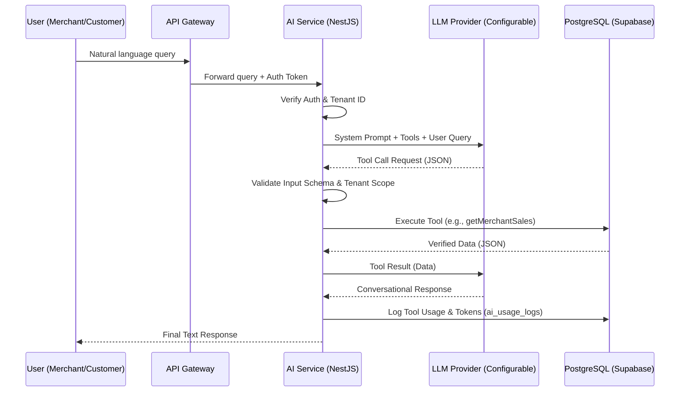
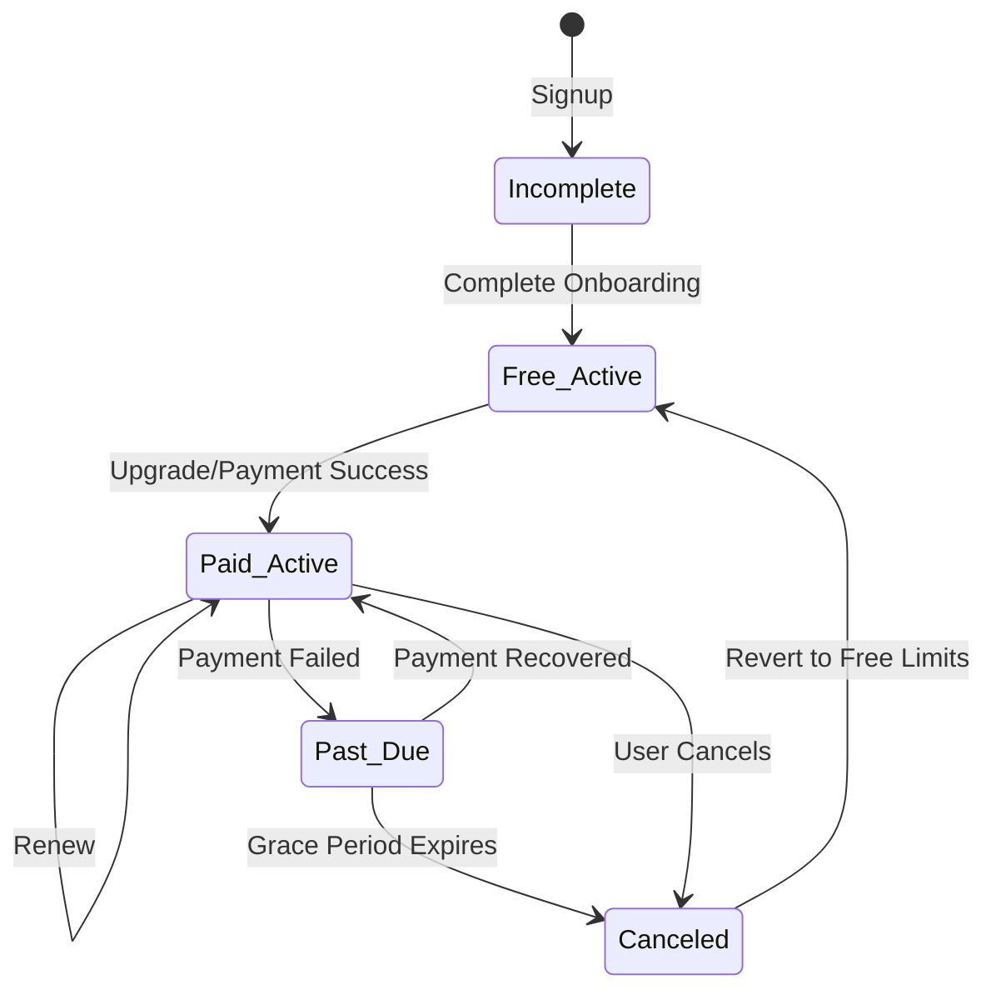

# SRS Part 3: Sections 14-19

## SECTION 14 — AI MERCHANT BUSINESS ASSISTANT

**Overview:** The AI Merchant Business Assistant provides conversational intelligence to help merchants manage their operations. Note: Conversational AI is a Phase 2 feature (smart dashboards will be provided first in MVP).

### 14.1 Functional Requirements

#### AI-MER-FR-001: Sales Intelligence
* **Description:** The system shall allow merchants to query sales data via natural language.
* **Actor:** Merchant
* **Preconditions:** Merchant is logged in and `ai_assistant_enabled` flag is true.
* **Trigger:** Merchant sends a message asking about sales (e.g., "What were yesterday's sales?" or "Show my top products").
* **Main Workflow:**
  1. Merchant submits query.
  2. AI orchestrator routes query and invokes the `getMerchantSales` tool.
  3. Tool retrieves scoped data from the PostgreSQL database.
  4. AI formulates a conversational response based on retrieved data.
  5. System presents response to the merchant.
* **Business Rules:**
  * BR-001: Responses must clearly distinguish between verified historical data and AI forecasts.
* **Validation Rules:**
  * VR-001: Token limits per subscription plan must be validated prior to processing.
* **Acceptance Criteria:**
  * Given a merchant asking about yesterday's sales, When the AI processes the request, Then it returns accurate, database-backed sales figures without hallucination.
* **Priority:** P1 (Phase 2)
* **Configurable:** Yes (Feature flag `ai_assistant_enabled`, AI model).

#### AI-MER-FR-002: Inventory Intelligence
* **Description:** The system shall allow merchants to check inventory status and receive reorder suggestions.
* **Actor:** Merchant
* **Preconditions:** Merchant has active products and AI enabled.
* **Trigger:** Merchant asks for inventory details (e.g., "What's low on stock?").
* **Main Workflow:**
  1. Merchant submits query.
  2. AI invokes `getInventoryStatus` tool.
  3. AI interprets results, highlighting low stock and slow movers.
  4. System displays the response.
* **Business Rules:**
  * BR-002: AI cannot directly alter inventory stock levels without human approval.
* **Acceptance Criteria:**
  * Given a request for low stock, When the AI responds, Then it lists actual products below their threshold levels.
* **Priority:** P1 (Phase 2)
* **Configurable:** Yes (Threshold limits per product/merchant).

#### AI-MER-FR-003: Customer Intelligence
* **Description:** The AI shall summarize customer behavior, retention, and promotion performance.
* **Actor:** Merchant
* **Preconditions:** AI enabled.
* **Trigger:** Merchant requests customer insights (e.g., "Who are my top repeat customers?").
* **Main Workflow:**
  1. AI orchestrator queries customer analytics tools.
  2. AI synthesizes and displays the data securely.
* **Business Rules:**
  * BR-003: Personally Identifiable Information (PII) beyond what the merchant owns is restricted.
* **Acceptance Criteria:**
  * Given a query for repeat customers, Then the AI returns aggregated data and anonymized/authorized customer names.
* **Priority:** P2 (Phase 2)
* **Configurable:** Yes (Data retention limits for queries).

#### AI-MER-FR-004: Marketing Assistance
* **Description:** The AI shall draft marketing materials, such as promotional messages or product descriptions.
* **Actor:** Merchant
* **Preconditions:** AI enabled.
* **Trigger:** Merchant asks to draft a promotion (e.g., "Write a WhatsApp ad for Diwali").
* **Main Workflow:**
  1. Merchant requests a draft.
  2. AI generates content tailored to the merchant's context and language preferences.
  3. AI presents the draft for approval.
* **Business Rules:**
  * BR-004: All outbound customer communications generated by AI require explicit human approval before sending.
* **Acceptance Criteria:**
  * Given a request for a Telugu product description, Then the AI returns a grammatically correct draft for review.
* **Priority:** P1 (Phase 2)
* **Configurable:** Yes (Default language per merchant).

#### AI-MER-FR-005: Business Recommendations
* **Description:** The AI shall suggest business improvements (e.g., cross-selling, replenishment).
* **Actor:** Merchant
* **Preconditions:** AI enabled, sufficient historical data exists.
* **Trigger:** Merchant asks for advice or system proactively suggests based on triggers.
* **Main Workflow:**
  1. AI analyzes aggregate merchant data via tools.
  2. AI formulates actionable recommendations.
* **Business Rules:**
  * BR-005: Recommendations must be labeled as suggestions, not verified facts.
* **Acceptance Criteria:**
  * Given a trend in a specific category, Then the AI suggests related items to stock up on.
* **Priority:** P2 (Phase 2)
* **Configurable:** Yes.

### 14.2 AI Design Requirements

* **AI-DES-001 (Orchestration):** Use tool-calling agent pattern.
* **AI-DES-002 (Function Calling):** Leverage OpenAI-compatible function calling.
* **AI-DES-003 (Merchant-specific access):** Tools must strictly use tenant-scoped data.
* **AI-DES-004 (Verified DB retrieval):** AI must query DB via tools, never rely on LLM memory for facts.
* **AI-DES-005 (Conversation history):** Stored in DB, retention configurable.
* **AI-DES-006 (Persistent preferences):** AI must respect merchant language and preferred metrics.
* **AI-DES-007 (Context management):** Managed via system prompt + tool schemas + recent conversation history.
* **AI-DES-008 (Model selection):** AI model is configurable via ENV (`AI_MODEL`, `AI_PREMIUM_MODEL`) and routed per query complexity.
* **AI-DES-009 (Cost control):** Enforce per-merchant token budgets with configurable limits.
* **AI-DES-010 (Usage limits):** Tied to subscription plans (e.g., Free = 20 queries/mo).
* **AI-DES-011 (Human approval):** Mandatory for price changes, stock adjustments, order modifications, and customer comms.
* **AI-DES-012 (Error handling):** Graceful fallback if AI API fails or budget exceeded.
* **AI-DES-013 (Auditability):** Log every AI tool call with inputs/outputs to `ai_usage_logs`.
* **AI-DES-014 (Prompt-injection protection):** Implement input sanitization and output validation.
* **AI-DES-015 (Privacy protection):** Cross-tenant data must never enter prompts.

---

## SECTION 15 — AI CUSTOMER SHOPPING ASSISTANT

**Overview:** The AI Customer Shopping Assistant helps buyers find products, compare prices, and manage orders. Note: Phase 2 feature via feature flag.

### 15.1 Functional Requirements

#### AI-CUST-FR-001: Natural Language Search & Discovery
* **Description:** Customers can find products and merchants using natural language.
* **Actor:** Customer
* **Preconditions:** Customer is on the marketplace frontend; AI assistant enabled.
* **Trigger:** Customer asks "Where can I find fresh mangoes nearby?"
* **Main Workflow:**
  1. Customer submits query.
  2. AI queries `searchProducts` tool filtered by customer location/pincode.
  3. AI returns relevant items, prices, and merchant names.
* **Business Rules:**
  * BR-006: AI must NOT fabricate products, prices, stock, or delivery promises.
* **Validation Rules:**
  * VR-002: Customer queries must be scoped to merchants servicing their pincode.
* **Acceptance Criteria:**
  * Given a request for an item, When the AI answers, Then it only returns verified available stock from actual DB records.
* **Priority:** P1 (Phase 2)
* **Configurable:** Yes (Feature flag).

#### AI-CUST-FR-002: Order and Cart Assistance
* **Description:** Customers can ask for order status or cart help.
* **Actor:** Customer
* **Preconditions:** Customer has an active order or cart.
* **Trigger:** Customer asks "Where is my order?"
* **Main Workflow:**
  1. AI invokes `getOrderStatus` tool scoped to the authenticated customer ID.
  2. AI formats the status for the user.
* **Business Rules:**
  * BR-007: Customer data isolation must be strictly enforced.
* **Acceptance Criteria:**
  * Given a request for order status, Then the system returns only the order belonging to the logged-in user.
* **Priority:** P1 (Phase 2)
* **Configurable:** Yes.

#### AI-CUST-FR-003: Multilingual Support & Support Escalation
* **Description:** The assistant supports multiple languages and can escalate to human support.
* **Actor:** Customer
* **Preconditions:** AI assistant active.
* **Trigger:** User speaks in Telugu or requests human help.
* **Main Workflow:**
  1. AI detects language and responds appropriately, or routes to human support workflow if requested.
* **Acceptance Criteria:**
  * Given a query in Telugu, Then the AI responds in Telugu.
* **Priority:** P2 (Phase 2)
* **Configurable:** Yes (Supported languages).

---

## SECTION 16 — AI AGENT ARCHITECTURE

**Overview:** The AI architecture uses an OpenAI-compatible tool-calling agent pattern. This avoids vendor lock-in and allows seamless switching between OpenAI, Azure, Ollama, etc.

### 16.1 AI Architecture Evaluation & Recommendation
* **Evaluated:** Direct LLM API, Tool-Calling Agents, RAG, Semantic Search, Structured DB Queries.
* **Recommendation:** **OpenAI-compatible tool-calling agent pattern**. The LLM acts as an orchestrator, converting user intent into structured JSON tool calls. Tools execute securely on the backend (NestJS) against the PostgreSQL database (Single Source of Truth), and results are fed back to the LLM to generate the final response.

### 16.2 Mermaid Diagram: AI Agent Architecture



### 16.3 Backend Tool Specifications

All tools enforce Server-Side Merchant ID Injection. The system never trusts tenant IDs generated by the AI.

#### 1. getMerchantSales()
* **Purpose:** Retrieve aggregated sales data for a specific period.
* **Input Schema (JSON):**
  ```json
  {
    "type": "object",
    "properties": {
      "startDate": { "type": "string", "format": "date" },
      "endDate": { "type": "string", "format": "date" }
    },
    "required": ["startDate", "endDate"]
  }
  ```
* **Output Schema (JSON):**
  ```json
  {
    "totalRevenue": 15000,
    "orderCount": 45,
    "topProducts": [{ "name": "Rice", "qty": 10 }]
  }
  ```
* **Auth & Data Scope:** Requires `merchant` role. `merchant_id` is injected from the JWT token.
* **Validation & Errors:** Validates date formats. Returns 400 for invalid dates, 403 for unauthorized access.
* **Audit:** Logged to `ai_usage_logs`.

#### 2. getInventoryStatus()
* **Purpose:** Check current stock levels.
* **Input Schema:**
  ```json
  {
    "type": "object",
    "properties": {
      "filter": { "type": "string", "enum": ["low_stock", "all", "out_of_stock"] }
    }
  }
  ```
* **Output Schema:** Array of product objects with `id`, `name`, `stockLevel`, `threshold`.
* **Scope:** Scoped by `merchant_id`.

#### 3. searchProducts()
* **Purpose:** Find products for customers.
* **Input Schema:**
  ```json
  {
    "type": "object",
    "properties": {
      "query": { "type": "string" },
      "pincode": { "type": "string" }
    },
    "required": ["query", "pincode"]
  }
  ```
* **Output Schema:** Array of products with pricing and merchant info.
* **Scope:** Public access, restricted by customer pincode vs merchant delivery zones.

#### 4. getOrderStatus()
* **Purpose:** Retrieve order state.
* **Input Schema:**
  ```json
  {
    "type": "object",
    "properties": {
      "orderId": { "type": "string" }
    },
    "required": ["orderId"]
  }
  ```
* **Output Schema:** Order details and current status.
* **Scope:** Requires `customer` or `merchant` role. Server validates ownership of `orderId`.

#### 5. generateMarketingDraft()
* **Purpose:** Create drafts for marketing.
* **Input Schema:**
  ```json
  {
    "type": "object",
    "properties": {
      "campaignType": { "type": "string" },
      "targetAudience": { "type": "string" },
      "language": { "type": "string" }
    }
  }
  ```
* **Output Schema:** Text string (draft content).
* **Scope:** `merchant` only.

#### 6. getMerchantAnalytics()
* **Purpose:** Retrieve advanced metrics (AOV, retention).
* **Input Schema:**
  ```json
  {
    "type": "object",
    "properties": {
      "metric": { "type": "string", "enum": ["aov", "retention", "growth"] }
    }
  }
  ```
* **Output Schema:** Key-value metric data.
* **Scope:** `merchant` only, scoped by `merchant_id`.

#### 7. createReorderDraft()
* **Purpose:** Prepare a draft purchase order for low-stock items.
* **Input Schema:**
  ```json
  {
    "type": "object",
    "properties": {
      "supplierId": { "type": "string", "optional": true }
    }
  }
  ```
* **Output Schema:** Draft PO object (requires human approval to finalize).
* **Scope:** `merchant` only.

### 16.4 Safeguards
* **Prompt Injection Defense:** Input sanitization and strict structured output validation via JSON Schema.
* **Cross-Tenant Prevention:** Row-Level Security (RLS) in PostgreSQL + Server-Side `merchant_id` injection in backend tools.
* **Action Blocking:** AI tools are strictly Read-Only or Create-Draft. Actions like `updatePrice` or `publishAd` are excluded from the AI's toolset and require standard UI interactions by a human.
* **Cost Limits:** API token tracking enforced per request.

---

## SECTION 17 — MULTILINGUAL SUPPORT

**Overview:** The system must cater to the local demographic with English and Telugu for MVP, and Hindi in Phase 2.

### 17.1 Functional Requirements

#### I18N-FR-001: Multilingual UI
* **Description:** The UI shall support English and Telugu out of the box using a standard i18n framework.
* **Priority:** P0 (MVP)
* **Configurable:** Yes (Language toggle).

#### I18N-FR-002: User-Generated Content Localization
* **Description:** Merchants can provide product descriptions in multiple languages.
* **Priority:** P1
* **Configurable:** Yes.

#### I18N-FR-003: AI Multilingual Conversations
* **Description:** The AI Assistant system prompt shall instruct the model to detect and respond in the user's preferred language (English or Telugu).
* **Priority:** P1 (Phase 2)

#### I18N-FR-004: Extensibility
* **Description:** The architecture must allow adding new languages (e.g., Hindi) without database restructuring (using JSONB for localized fields or distinct translation tables).
* **Priority:** P0

#### I18N-FR-005: Voice Assistance
* **Description:** Support for speech-to-text and text-to-speech interaction.
* **Priority:** P3 (Phase 3 - Optional Future Feature).

---

## SECTION 18 — MERCHANT BILLING AND SUBSCRIPTIONS

**Overview:** SaaS subscription management for merchants using a freemium model.

### 18.1 Functional Requirements

#### SUB-FR-001: Plan Management
* **Description:** The platform shall support 4 tiers: Free (₹0), Basic (₹499), Professional (₹999), Premium (₹1,999).
* **Business Rules:**
  * BR-008: All prices and limits are driven by the `subscription_plans` DB table.
* **Acceptance Criteria:**
  * Given an admin updating a plan price in the DB, When a new merchant signs up, Then they are presented with the updated price.
* **Priority:** P0
* **Configurable:** Yes (DB table).

#### SUB-FR-002: Usage Limits & Quotas
* **Description:** Limits on products, orders, employees, and AI queries must be enforced per plan (e.g., Free: 50 products, 100 orders/mo, 20 AI queries/mo).
* **Priority:** P0
* **Configurable:** Yes.

#### SUB-FR-003: Subscription Lifecycle
* **Description:** Merchants can activate, renew, upgrade, downgrade, or cancel plans.
* **Priority:** P0

#### SUB-FR-004: Grace Periods and Failed Payments
* **Description:** Failed renewals enter a 7-day grace period before account downgrade to Free tier restrictions.
* **Priority:** P1
* **Configurable:** Yes (Grace period duration).

#### SUB-FR-005: Invoices & Promos
* **Description:** Automated PDF invoices and promotional offer codes must be supported.
* **Priority:** P1

### 18.2 Subscription State Machine



---

## SECTION 19 — PLATFORM ADMINISTRATION

**Overview:** The super-admin dashboard for managing the Shoppie platform.

### 19.1 Functional Requirements

#### ADM-FR-001: Global Dashboard
* **Description:** Admins can view platform metrics, manage merchants, users, subscriptions, categories, AI limits, commissions, and feature flags.
* **Actor:** Super Admin
* **Preconditions:** User has `super_admin` role.
* **Priority:** P0

#### ADM-FR-002: Configuration Management
* **Description:** Admins can edit `platform_config`, `subscription_plans`, and `business_categories` directly from the UI without code changes.
* **Priority:** P0

#### ADM-FR-003: Merchant Approval
* **Description:** Admins can approve or reject new merchant registrations if `auto_approve_merchants` is false.
* **Priority:** P0
* **Configurable:** Yes (Feature flag).

#### ADM-FR-004: Audit & Security
* **Description:** Elevated actions (e.g., deleting a merchant, modifying a subscription plan) require a confirmation prompt and are logged in an audit trail.
* **Priority:** P1

### 19.2 Admin Permission Matrix

| Action | Admin | Support Staff | Read-Only Viewer |
|---|---|---|---|
| View Platform Metrics | Yes | Yes | Yes |
| Manage Merchants/Approvals | Yes | Yes | No |
| View Orders/Customer Data | Yes | Yes | No |
| Modify Subscription Plans | Yes | No | No |
| Change Feature Flags | Yes | No | No |
| Access Audit Logs | Yes | No | No |
| Manage Billing/Gateway | Yes | No | No |

---
**End of SRS Sections 14-19**
