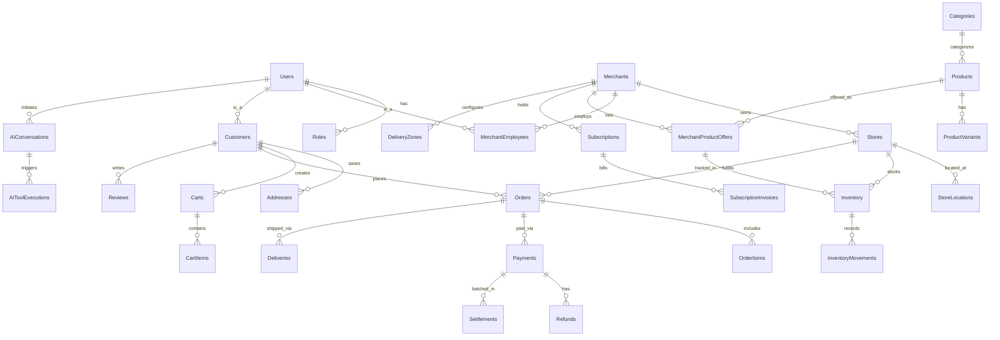
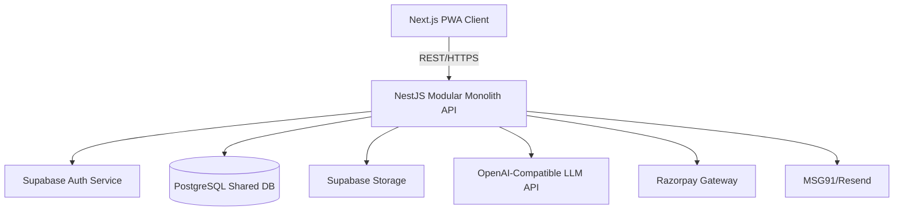
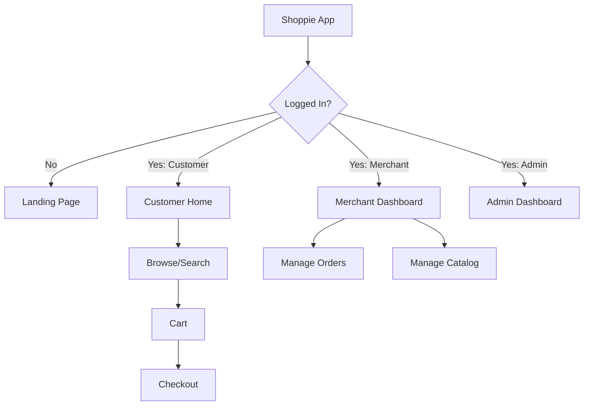

# Shoppie Platform — Software Requirements Specification (Part 4)

## SECTION 20 — DATABASE REQUIREMENTS

The database design strictly enforces the "Shared Commerce Infrastructure" and "Secure Multi-Tenancy" architectural principles. All merchant-specific tables utilize Row-Level Security (RLS) based on a `merchant_id` column to ensure strict data isolation.

### 20.1 Entity Relationship Diagram



### 20.2 Data Model Definitions

#### 20.2.1 Core Identity & Access
*   **Users**: Purpose: Central identity (Supabase Auth reference). Fields: id (PK, UUID), email, phone, created_at. Retention: Permanent until deleted.
*   **Roles**: Purpose: RBAC definitions. Fields: id (PK), name, description.
*   **Permissions**: Purpose: Granular access control. Fields: id (PK), role_id (FK), resource, action.
*   **Merchants**: Purpose: Tenant entity. Fields: id (PK, UUID), name, gstin, status. Retention: Soft delete.
*   **MerchantEmployees**: Purpose: Merchant staff access. Fields: id (PK), merchant_id (FK), user_id (FK), role_id (FK).
*   **Stores**: Purpose: Logical storefronts. Fields: id (PK), merchant_id (FK), name.
*   **StoreLocations**: Purpose: Physical locations. Fields: id (PK), store_id (FK), address, pincode, gps_coordinates.

#### 20.2.2 Catalog & Inventory
*   **Categories**: Purpose: Global taxonomy. Fields: id (PK), name, parent_id (FK), commission_rate (Configurable).
*   **Products**: Purpose: Global product registry. Fields: id (PK), category_id (FK), name, brand, description, image_urls.
*   **ProductVariants**: Purpose: Global variations (e.g., 500g, 1kg). Fields: id (PK), product_id (FK), attributes (JSONB).
*   **MerchantProductOffers**: Purpose: Merchant-specific listing & pricing. Fields: id (PK), merchant_id (FK), product_id (FK), price, is_active.
*   **Inventory**: Purpose: Stock levels per store. Fields: id (PK), store_id (FK), offer_id (FK), quantity, low_stock_threshold.
*   **InventoryMovements**: Purpose: Stock audit trail. Fields: id (PK), inventory_id (FK), change_amount, reason.

#### 20.2.3 Customers & Orders
*   **Customers**: Purpose: Marketplace shoppers. Fields: id (PK), user_id (FK), full_name.
*   **Addresses**: Purpose: Delivery addresses. Fields: id (PK), customer_id (FK), line1, pincode, type.
*   **Carts**: Purpose: Shopping carts (single-merchant MVP). Fields: id (PK), customer_id (FK), merchant_id (FK), status.
*   **CartItems**: Purpose: Items in cart. Fields: id (PK), cart_id (FK), offer_id (FK), quantity.
*   **Orders**: Purpose: Confirmed purchases. Fields: id (PK), customer_id (FK), store_id (FK), total_amount, status.
*   **OrderItems**: Purpose: Locked order lines. Fields: id (PK), order_id (FK), offer_id (FK), quantity, unit_price.

#### 20.2.4 Financial & Fulfillment
*   **Payments**: Purpose: Transaction tracking (Razorpay). Fields: id (PK), order_id (FK), gateway_txn_id, amount, status.
*   **Refunds**: Purpose: Refund tracking. Fields: id (PK), payment_id (FK), amount, status.
*   **Settlements**: Purpose: B2B payouts. Fields: id (PK), merchant_id (FK), amount, reference_id, settled_at.
*   **Deliveries**: Purpose: Fulfillment tracking. Fields: id (PK), order_id (FK), status, tracking_url, delivery_fee.

#### 20.2.5 Platform & Operations
*   **Subscriptions**: Purpose: SaaS plans for merchants. Fields: id (PK), merchant_id (FK), plan_id, valid_until.
*   **SubscriptionInvoices**: Purpose: SaaS billing. Fields: id (PK), subscription_id (FK), amount, invoice_url.
*   **Promotions**: Purpose: Discount codes. Fields: id (PK), merchant_id (FK), code, discount_type, value, active.
*   **Reviews**: Purpose: Product/Merchant feedback. Fields: id (PK), order_id (FK), customer_id (FK), rating, comment.
*   **AIConversations**: Purpose: AI chat logs. Fields: id (PK), user_id (FK), context, token_usage. Retention: 90 days.
*   **AIToolExecutions**: Purpose: Audit of AI actions. Fields: id (PK), conversation_id (FK), tool_name, parameters.
*   **AuditLogs**: Purpose: Security & compliance. Fields: id (PK), user_id (FK), action, resource, timestamp.
*   **Notifications**: Purpose: Alerts. Fields: id (PK), user_id (FK), type, message, read_status.
*   **PlatformConfig**: Purpose: Global settings. Fields: key (PK), value (JSONB).
*   **FeatureFlags**: Purpose: Toggle features. Fields: flag_name (PK), is_enabled (Boolean).
*   **DeliveryZones**: Purpose: Supported areas. Fields: id (PK), merchant_id (FK), pincodes (JSONB), flat_fee.

### 20.3 Multi-Tenant Strategy
- **Shared Database**: All tenants share a single logical database schema to minimize operational overhead.
- **Row-Level Security (RLS)**: Implemented natively in PostgreSQL. Every query automatically filters rows where `tenant_id` (or `merchant_id`) matches the authenticated user's context.

### 20.4 Data Retention Policies
- Transational Data (Orders, Payments): 7 years (regulatory requirement).
- AI Conversations & Logs: 90 days (configurable).
- Audit Logs: 1 year.

---

## SECTION 21 — SOFTWARE ARCHITECTURE

**Requirement ID**: ARCH-FR-001

### 21.1 Architecture Evaluation
1. **Modular Monolith (RECOMMENDED)**: Simple deployment, easy end-to-end testing, fits solo developer workflow, scales adequately for MVP and immediate growth. Modules enforce strict boundaries within a single runtime.
2. **Microservices**: Rejected. Unnecessary network latency, complex DevOps, overkill for MVP.
3. **Serverless**: Rejected. Risk of vendor lock-in, cold start latency on critical commerce paths.
4. **Managed Backend**: Rejected. Insufficient customization for the specific B2B2C marketplace model.

### 21.2 Stack Evaluation
- **Next.js (PWA)**: Excellent for SEO (Marketplace) and offline-capable mobile experience (PWA).
- **NestJS**: Ideal for Modular Monolith. Strict TypeScript typing, decorators, and dependency injection align perfectly with enterprise architecture.
- **PostgreSQL**: Robust, ACID compliant, supports RLS.
- **Supabase**: Auth and Storage only. Eliminates manual JWT/Session management.
- **LLM APIs**: Standardized on OpenAI-compatible endpoints.
- **Razorpay**: Best-in-class for India; integrated via Adapter pattern for future swappability.

### 21.3 Architecture Diagram



### 21.4 Module Boundaries (NestJS)
- `AuthModule`: Identity, JWT validation, roles.
- `MerchantModule`: Tenant lifecycle, settings.
- `CatalogModule`: Global products, categories.
- `StoreModule`: Physical stores, Merchant offers, Inventory.
- `MarketplaceModule`: Customer search, discovery.
- `CheckoutModule`: Cart, Order, Payment orchestration.
- `SubscriptionModule`: SaaS billing for merchants.
- `AIModule`: Prompts, tool routing, token tracking.

---

## SECTION 22 — API REQUIREMENTS

All APIs strictly follow RESTful conventions, prefixed with `/api/v1/`.

### 22.1 Authentication APIs
- `POST /api/v1/auth/register` (Public) - Create user.
- `POST /api/v1/auth/login` (Public) - Authenticate & return JWT.
- `POST /api/v1/auth/otp/send` (Public) - Trigger SMS OTP.

### 22.2 Merchant APIs
- `POST /api/v1/merchants` (Auth: Admin/User) - Create tenant.
- `GET /api/v1/merchants/:id` (Auth: Merchant) - Get details. Idempotent.

### 22.3 Catalog & Store APIs
- `GET /api/v1/products` (Public) - Search products (pagination: `?page=1&limit=20`).
- `POST /api/v1/stores/:id/offers` (Auth: Merchant) - List product for sale.

*(Detailed APIs cover Inventory, Marketplace, Cart, Orders, Payments, Delivery, Subscriptions, AI, Notifications, and Administration following standard CRUD & Action verbs)*

### 22.4 Representative JSON Specifications

**Request**: `POST /api/v1/checkout/orders`
```json
{
  "cart_id": "cart-uuid-123",
  "delivery_address_id": "addr-uuid-456",
  "payment_method": "UPI"
}
```

**Response**: `201 Created`
```json
{
  "order_id": "ORD-10023",
  "total_amount": 530.00,
  "status": "PAYMENT_PENDING",
  "payment_gateway_order_id": "order_Fk...23"
}
```

---

## SECTION 23 — UI/UX REQUIREMENTS

**Requirement ID**: UI-FR-001

### 23.1 Design Principles
- **Mobile-First**: Target cheap Android devices on 3G/4G networks.
- **Offline-Capable**: Service Worker caching for static assets, basic product catalog, and offline cart modifications.
- **Language**: English + Telugu (Configurable MVP).

### 23.2 Customer Application (10 Screens)
1. **Home**: Search bar, category grid, nearby merchants.
2. **Location Selection**: Auto-detect via HTML5 Geolocation or manual Pincode entry.
3. **Product Search**: Typeahead, filters (price, category).
4. **Merchant Listing**: Distance, ratings, delivery fee.
5. **Product Details**: Images, variants, add to cart.
6. **Cart**: Order summary, taxes, delivery fee computation.
7. **Checkout**: Address selection, payment method selection.
8. **Orders**: Order history, live status tracking.
9. **Profile**: Settings, addresses.
10. **AI Shopping Assistant** (Phase 2): Conversational interface for discovery.

### 23.3 Merchant Application (10 Screens)
1. **Registration**: GSTIN (optional), phone verification.
2. **Onboarding**: Store location, basic config.
3. **Dashboard**: Metrics (sales, pending orders).
4. **Products**: Bulk CSV import, manual add, variant management.
5. **Inventory**: Low stock alerts, stock updates.
6. **Orders**: Accept/Reject, mark as dispatched.
7. **Customers**: Basic CRM, lifetime value.
8. **Reports**: Tax, sales exports.
9. **Subscriptions**: Plan upgrades, billing history.
10. **AI Business Assistant** (Phase 2): Natural language insights.

### 23.4 Navigation Flow



---

## SECTION 24 — NON-FUNCTIONAL REQUIREMENTS

| Req ID | Attribute | Threshold / Measure (Configurable) |
|---|---|---|
| PERF-NFR-001 | API Latency (Read) | p95 ≤ 200ms |
| PERF-NFR-002 | API Latency (Write) | p95 ≤ 500ms |
| PERF-NFR-003 | App Load Time | First Contentful Paint < 2.0s on 3G |
| AVAIL-NFR-001 | Uptime | 99.5% (Max 3.65 hours downtime/month) for MVP |
| SCALE-NFR-001 | Concurrency | MVP: 50 concurrent users. Arch support: 5,000 |
| DATA-NFR-001 | RPO (Recovery Point) | < 1 hour data loss tolerance |
| DATA-NFR-002 | RTO (Recovery Time) | < 4 hours to full operational restore |
| SEC-NFR-001 | Tenant Isolation | 100% of merchant data accessed via strict RLS |

*Note: Resource limits, concurrency caps, and timeout thresholds are configured via environment variables.*

---

## SECTION 25 — SECURITY AND PRIVACY

**Requirement IDs**: SEC-FR-001 to SEC-FR-020, PRIV-FR-001

### 25.1 Security Implementation Details
1. **Authentication**: Supabase Auth (JWT based). MFA disabled for MVP but natively supported.
2. **Authorization**: RBAC (Admin, Merchant Owner, Merchant Staff, Customer).
3. **Tenant Isolation**: PostgreSQL RLS ensures `merchant_id = current_user_merchant_id()`.
4. **Encryption**: TLS 1.3 for data in transit. AES-256 for data at rest (Supabase default).
5. **Secrets Management**: No hardcoded secrets. Injected via `.env` files in CI/CD pipeline.
6. **API Security**: 
   - Global Rate Limiting: Configurable (default 100 req/min per IP).
   - Strict Input Validation: Zod/class-validator pipelines in NestJS.
   - CORS restricted to defined UI domains.
7. **Payment Security**: SAQ-A PCI DSS compliance. No card data touches Shoppie servers; all handled via Razorpay iframe/redirect.

### 25.2 Privacy & Compliance (Indian DPDP Act)
- **Data Minimization**: Collect only phone, name, and address.
- **Consent**: Explicit consent checkboxes during registration (configurable text).
- **Right to Erasure**: Hard delete functionality for Customer accounts.
- **Data Localization**: Database hosted in Indian AWS/Supabase region.

*Legal Review Required: Terms of Service, Privacy Policy, Merchant Agreements, and precise DPDP consent phrasing.*
